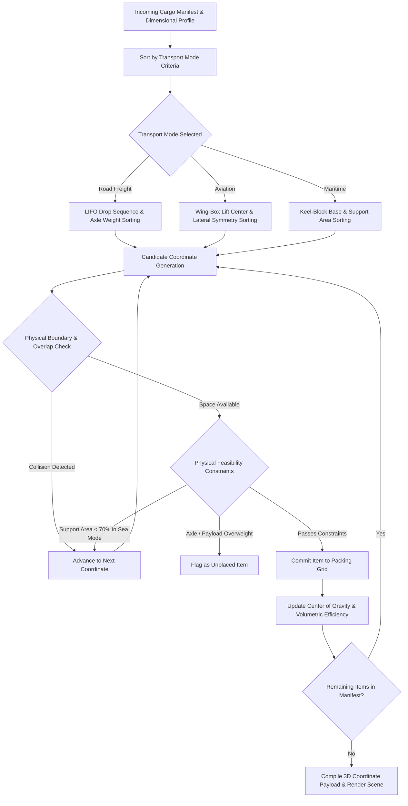
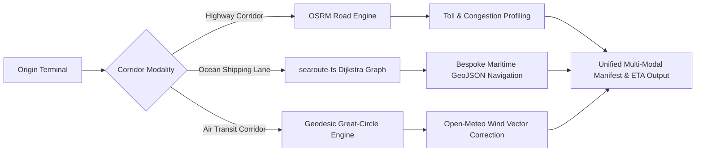
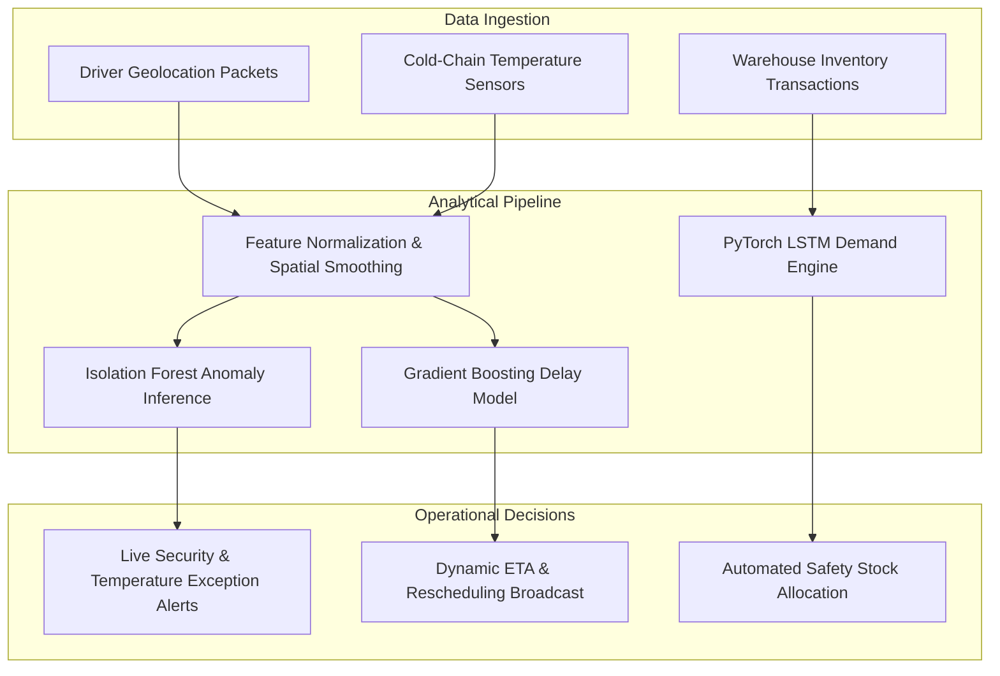
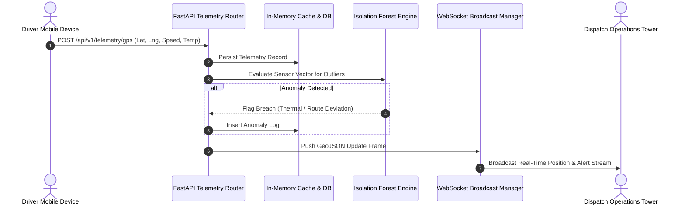

# LogiLoad 3D: Enterprise Multi-Modal Freight Optimization and Telematics Platform

## Executive Summary

LogiLoad 3D is an enterprise-grade logistics optimization platform engineered to solve multi-modal cargo loading, intermodal route planning, dynamic weight-and-balance distribution, and predictive fleet operations. Designed for commercial carrier networks, supply chain aggregators, and freight forwarding operations across land, sea, and air corridors, LogiLoad provides real-time WebGL spatial packing, deterministic and deep reinforcement learning (DRL) bin packing algorithms, Great-Circle and OSRM routing engines, and automated telematics anomaly detection.

The platform eliminates operational inefficiencies arising from sub-optimal volumetric stowage, axle overweight violations, aviation Center of Gravity (CoG) excursions, and uncoordinated multi-modal handoffs.

---

## High-Level System Architecture

The LogiLoad system is structured as a decoupled multi-tier architecture consisting of a client presentation layer (React 19, Three.js, Leaflet), an asynchronous API and orchestration layer (FastAPI, WebSockets), an analytical and optimization engine (PyTorch, Scikit-Learn, OpenCV), and an enterprise persistence layer (SQLAlchemy ORM, SQLite/PostgreSQL).

```mermaid
graph TB
    subgraph ClientLayer ["Client Presentation Layer (React 19 / TypeScript / Vite)"]
        UI_Dispatch["Operations & Dispatch Console"]
        UI_Driver["Driver Telematics Mobile Portal"]
        UI_3D["WebGL 3D Viewport (Three.js / R3F)"]
        UI_GIS["Multi-Modal GIS Mapping (Leaflet / OSRM)"]
    end

    subgraph GatewayLayer ["Application & API Gateway (FastAPI)"]
        AUTH["JWT Authentication & RBAC"]
        ROUTER_FLEET["Fleet & Vehicle Service"]
        ROUTER_SHIP["Shipment & Manifest Service"]
        ROUTER_OPT["Optimization & Packing Router"]
        ROUTER_TEL["Live Telematics & WebSocket Engine"]
        ROUTER_AI["Predictive AI & Anomaly Router"]
    end

    subgraph OptimizationLayer ["Analytical, Optimization & ML Subsystems"]
        BPP_ENG["3D Bin Packing Solver (Deterministic / DRL)"]
        CoG_ENG["Static Moment & Balance Calculator"]
        ROUTE_ENG["Intermodal Routing (Road / Sea / Air)"]
        CV_ENG["Computer Vision Dimensioning (OpenCV)"]
        ML_MODELS["Predictive Suite (Delay, Cost, Demand, GNN)"]
        ANOM_ENG["Telemetry Anomaly Isolation Forest"]
    end

    subgraph PersistenceLayer ["Persistence & External Services"]
        DB[(Relational Database / SQLite / PostgreSQL)]
        TELEMETRY_CACHE["In-Memory Telemetry Ring Buffer"]
        GIS_OSRM["OSRM Road Routing Service"]
        METEO_API["Open-Meteo Atmospheric Data"]
        LLM_GW["OpenRouter LLM Inference Gateway"]
    end

    UI_Dispatch -->|REST / HTTPS| GatewayLayer
    UI_Driver -->|REST / Geolocation POST| ROUTER_TEL
    UI_Dispatch <-->|Full-Duplex WS| ROUTER_TEL
    UI_3D <-->|State Updates| BPP_ENG
    UI_GIS <-->|Route Requests| ROUTE_ENG

    ROUTER_FLEET --> DB
    ROUTER_SHIP --> DB
    ROUTER_OPT --> BPP_ENG
    ROUTER_OPT --> CoG_ENG
    ROUTER_TEL --> TELEMETRY_CACHE
    ROUTER_TEL --> DB
    ROUTER_TEL --> ANOM_ENG
    ROUTER_AI --> ML_MODELS
    ROUTER_AI --> CV_ENG
    ROUTER_AI --> LLM_GW

    ROUTE_ENG --> GIS_OSRM
    ROUTE_ENG --> METEO_API
    ML_MODELS --> DB
```



---

## Core System Modules

### 1. Multi-Modal 3D Cargo Packing Engine

The 3D Bin Packing Problem (3D-BPP) is an NP-hard combinatorial optimization challenge. LogiLoad incorporates specialized mode-aware solvers tailored to the physics of freight transport:

#### Road Freight Packing
- Utilizes Last-In, First-Out (LIFO) wall-filling heuristics.
- Prioritizes heavy cargo on the vehicle floor and coordinates placement according to delivery drop sequence to prevent dock reorganizations.
- Enforces payload weight envelopes (e.g., Tata LPT 1613, BharatBenz 1623R, Eicher chassis).

#### Air Cargo and Dynamic Balance Optimization
- Implements Center of Gravity (CoG) constrained packing around the Mean Aerodynamic Chord (MAC).
- Items are loaded laterally symmetric and clustered around the fuselage lift zone to maintain longitudinal and lateral trim within authorized forward and aft limits.
- Validates Unit Load Devices (ULDs), AMJ containers, and palletized aircraft freight.

#### Maritime Cargo Hold Stowage
- Enforces a minimum 70 percent under-support contact area to eliminate overhang instability and floating tier violations.
- Balances port and starboard moments to prevent vessel list and GM (metacentric height) degradation.



#### Physical Formulation for Center of Gravity (CoG)
The center of gravity along each Cartesian axis is evaluated continuously as items are positioned:

$$\text{CoG}_x = \frac{\sum_{i=1}^N (w_i \cdot x_i)}{\sum_{i=1}^N w_i}, \quad \text{CoG}_y = \frac{\sum_{i=1}^N (w_i \cdot y_i)}{\sum_{i=1}^N w_i}, \quad \text{CoG}_z = \frac{\sum_{i=1}^N (w_i \cdot z_i)}{\sum_{i=1}^N w_i}$$

Where:
- $w_i$ represents the mass of item $i$.
- $x_i, y_i, z_i$ are the spatial coordinates of the geometric centroid of item $i$ relative to the vehicle coordinate origin.

---

### 2. Multi-Modal Route Planning Architecture

The navigation engine supports three distinct routing modalities, orchestrating door-to-door multi-modal shipments.



- **Road Logistics**: Queries high-performance OpenStreetMap (OSRM) backends to compute highway mileage, multi-stop delivery routes, and automated toll expense schedules calibrated to Indian National Highway guidelines.
- **Maritime Transit**: Uses Dijkstra shortest-path algorithms applied to global marine shipping channel networks, avoiding terrestrial obstructions and respecting strait passage channels.
- **Air Freight**: Calculates spherical Great-Circle geodesic trajectories between IATA airport hubs, integrating live atmospheric wind vector grids from Open-Meteo to calibrate ground speeds and true arrival estimates.

---

### 3. Machine Learning and Predictive Analytics

The analytical engine comprises specialized predictive and operational models trained for logistics operations:

| Subsystem | Model Architecture | Primary Features / Inputs | Operational Target |
|---|---|---|---|
| **Delay Prediction** | HistGradientBoosting (Regressor + Classifier) | Distance, scheduled transit time, shipping tier, cargo mass, weather index | Predicted transit delay in minutes and binary risk classification |
| **Freight Cost Estimation** | HistGradientBoosting Regressor | Ton-kilometer profile, fuel benchmark, route distance, number of waypoints | Estimated transit expense in INR |
| **Regional Demand Forecasting** | 2-Layer PyTorch LSTM Recurrent Network | Historical inventory velocity, dealership sequence, temporal features | 7-day replenishment demand projections |
| **Telemetry Anomaly Detection** | Scikit-Learn IsolationForest | Speed variance, route divergence, cold-chain temperature, humidity | Automated breach detection and security alerting |
| **Transport Network Optimization** | GraphSAGE Graph Neural Network (GNN) | City hub node attributes, corridor distance, network adjacency | Corridor transit efficiency and bottleneck discovery |
| **DRL Packing Policy** | Neural Actor-Critic (Deep RL) | 12-dimensional state vector (container residual envelope, candidate box) | Optimal coordinate selection for complex geometries |
| **Dimensional Scanning** | Computer Vision (OpenCV Contours & Perspective) | Live camera frame, metric reference card (A4 / Credit Card) | Automatic crate dimension extraction |



---

### 4. Telemetry and Real-Time Operations Pipeline

The platform features end-to-end telematics ingestion capable of streaming GPS and sensor telemetry directly from mobile field units:



---

## Technical Stack

### Frontend & User Interface
- **Framework**: React 19, TypeScript, Vite
- **3D Visualization**: Three.js, React Three Fiber (`@react-three/fiber`), React Three Drei (`@react-three/drei`)
- **Geographic Information Systems**: Leaflet, `react-leaflet`, `searoute-ts`
- **Analytics & Dashboards**: Recharts, Lucide Icons, Pure CSS Glassmorphism
- **Export Engines**: jsPDF, jspdf-autotable, SheetJS (XLSX)

### Backend & Middleware
- **Framework**: FastAPI (Python 3.10+)
- **Asynchronous Server**: Uvicorn (ASGI)
- **Data Validation & Serialization**: Pydantic v2
- **ORM & Database**: SQLAlchemy with SQLite (default) / PostgreSQL support
- **Security**: OAuth2 with JWT (HMAC-SHA256) and BCrypt password hashing
- **Messaging**: Full-duplex WebSockets for real-time fleet telematics

### Machine Learning & Computer Vision
- **Deep Learning**: PyTorch (`torch`, `torch.nn`)
- **Classical ML & Ensembles**: Scikit-Learn (`HistGradientBoosting`, `IsolationForest`, `StandardScaler`)
- **Computer Vision**: OpenCV (`cv2`), NumPy
- **Model Serialization**: Joblib, Torch JIT

---

## API Endpoints Reference

### Authentication & Fleet Operations
- `POST /api/v1/auth/login` - Authenticate operator and generate JWT access token.
- `GET /api/v1/fleet/vehicles` - List registered fleet vehicles and payload dimensions.
- `GET /api/v1/fleet/dealerships` - Retrieve distribution centers and dealership hubs.
- `GET /api/v1/shipments` - Retrieve active cargo manifests, statuses, and waybills.

### AI Predictive Analytics & Optimization
- `POST /api/v1/ai/delay/predict` - Forecast shipment transit delay and late delivery probability.
- `POST /api/v1/ai/cost/predict` - Estimate multi-factor road transport expenses.
- `POST /api/v1/ai/demand/forecast` - Generate rolling LSTM regional replenishment forecasts.
- `POST /api/v1/ai/optimization/packing` - Execute DRL-assisted 3D bin packing optimization.
- `POST /api/v1/ai/optimization/route` - Solve multi-stop traveling salesperson / vehicle routing problems.
- `POST /api/v1/ai/vision/dimensions` - Extract physical dimensions from video or captured camera frames.
- `POST /api/v1/ai/chat/message` - Context-grounded conversational operations assistant.

### Telematics & Telemetry
- `POST /api/v1/telemetry/gps` - Ingest mobile or hardware GPS tracking packets.
- `GET /api/v1/telemetry/live` - Retrieve the most recent fleet telemetry snapshot.
- `WebSocket /api/v1/telemetry/ws` - Connect to the full-duplex live fleet dispatch stream.

---

## Repository Structure

```
3d-TruckLoad-Optimizer/
|-- backend/                       # FastAPI application core
|   |-- routers/                   # Modular API route controllers
|   |   |-- ai_anomaly_router.py   # Anomaly detection endpoints
|   |   |-- ai_chat_router.py      # Database-grounded LLM assistant
|   |   |-- ai_optimization_router.py # DRL and VRP optimization
|   |   |-- ai_prediction_router.py   # Delay, cost, and demand APIs
|   |   |-- ai_vision_router.py    # Computer vision dimensioning API
|   |   |-- auth_router.py         # Authentication and session management
|   |   |-- fleet_router.py        # Vehicle and driver management
|   |   |-- shipments_router.py    # Waybill and shipment CRUD
|   |   `-- telemetry_router.py    # Live GPS and WebSocket telematics
|   |-- auth.py                    # Token verification and password hashing
|   |-- config.py                  # Environment settings and paths
|   |-- database.py                # Database engine and session factory
|   |-- models.py                  # SQLAlchemy relational schemas
|   |-- schemas.py                 # Pydantic request and response models
|   |-- seed.py                    # Baseline database population routines
|   `-- main.py                    # Application entry point and ASGI pipeline
|-- components/                    # Reusable React UI components and 3D scenes
|-- ml/                            # Machine learning model source files
|   |-- models/                    # Neural networks and classical estimators
|   |   |-- anomaly_detector.py    # IsolationForest telemetry monitor
|   |   |-- cargo_vision.py        # Edge detection dimension estimator
|   |   |-- cost_model.py          # Freight rate gradient booster
|   |   |-- delay_model.py         # Logistics transit delay estimator
|   |   |-- demand_lstm.py         # PyTorch demand forecasting network
|   |   |-- drl_packing.py         # Deep reinforcement learning packer
|   |   |-- rl_routing.py          # Actor-Critic route sequencer
|   |   `-- transport_gnn.py       # Graph neural network for corridors
|   |-- train_all.py               # Master model training pipeline
|   `-- train_all_real.py          # Reproducible pipeline on reference datasets
|-- models/                        # Serialized model artifacts (.joblib, .pt)
|-- pages/                         # Core platform views and operational portals
|   |-- AdminDashboard.tsx         # Fleet control tower and fleet overview
|   |-- AirOptimizer.tsx           # Fuselage loading and Weight-and-Balance HUD
|   |-- AirRoutePlanner.tsx        # Geodesic flight routing with wind factors
|   |-- DriverDashboard.tsx        # In-cab mobile navigation and sensor stream
|   |-- Inventory.tsx              # Cargo inventory management and CSV import
|   |-- Optimizer.tsx              # 3D truck cargo packing environment
|   |-- Performance.tsx            # Logistics analytics and utilization charts
|   |-- RoutePlanner.tsx           # OSRM highway route optimization
|   |-- SeaOptimizer.tsx           # Maritime vessel cargo hold stowage
|   `-- SeaRoutePlanner.tsx        # Global marine shipping lane router
|-- services/                      # Client-side algorithms and API interfaces
|   |-- packer.ts                  # Deterministic 3D bin packing engine
|   |-- hybridOptimizer.ts         # Hybrid heuristic-DRL pipeline
|   |-- routing.ts                 # OSRM navigation and polyline handling
|   |-- tollCalculator.ts          # National highway toll cost calculation
|   `-- websocket.ts               # Resilient client WebSocket subscriber
|-- tests/                         # Integration and regression test suites
|-- App.tsx                        # Root routing and application composition
|-- package.json                   # Frontend dependencies and run scripts
`-- vite.config.ts                 # Vite bundler configuration
```

---

## Installation and Deployment

### Prerequisites
- Node.js (version 18.0 or higher)
- Python (version 3.10 or higher)
- Git

### 1. Environment Configuration
Clone the repository and copy the environment configuration template:
```bash
cp .env.example .env
```

Review `.env` and configure operational parameters, including `DATABASE_URL`, `JWT_SECRET`, and optional external API credentials (`OPENROUTER_API_KEY` for LLM tooling).

### 2. Frontend Setup
Install npm dependencies and launch the local Vite development server:
```bash
npm install
npm run dev
```
The client interface initializes by default at `http://localhost:5173`.

### 3. Backend Setup
Create an isolated Python virtual environment, install backend dependencies, and launch the Uvicorn ASGI server:
```bash
python3 -m venv venv
source venv/bin/activate  # On Windows: venv\Scripts\activate
pip install -r backend/requirements.txt
python backend/main.py
```
The FastAPI REST services and OpenAPI documentation become accessible at:
- Service Root: `http://localhost:8000`
- Interactive OpenAPI Docs: `http://localhost:8000/api/v1/docs`

### 4. Machine Learning Model Training (Optional)
To retrain and regenerate model artifacts stored in `models/`:
```bash
python ml/train_all.py
```

---

## Verification and Testing

Execute the automated backend test suite to validate database initialization, authentication security, telemetry ingestion, and AI model health:
```bash
pytest tests/test_ai_platform.py -v
```

All integration suites test live endpoint responses against active FastAPI middleware and ensure model tensors and estimators initialize correctly.

---

## Operational Baseline and Architecture Principles

1. **Separation of Concerns**: Deterministic physical constraints (such as geometric overlap checks and support area mechanics) operate independently of neural heuristics, ensuring that safety-critical packing rules cannot be bypassed by exploratory model behavior.
2. **Deterministic Fallbacks**: All deep learning and reinforcement learning components feature deterministic algorithmic fallbacks (e.g., maximal cuboid space decomposition and classical nearest-neighbor route heuristics) in the event of inference timeouts or numerical instabilities.
3. **Auditability**: Every prediction, anomaly event, and optimization run is recorded in the operational database alongside the responsible model identifier and version string for operational traceability.
